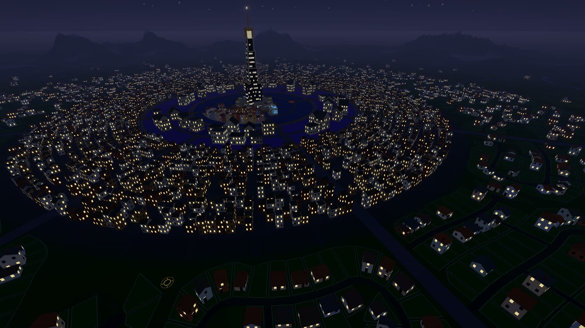
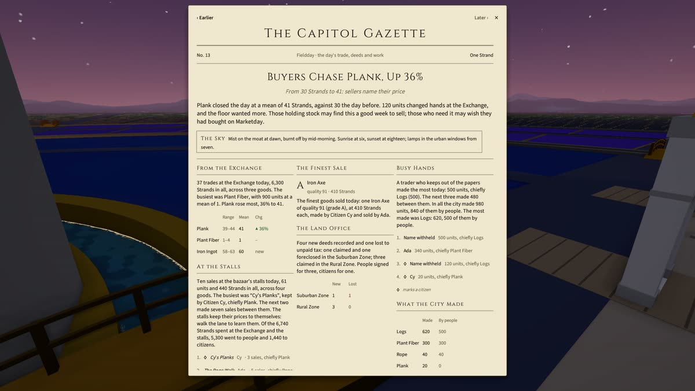
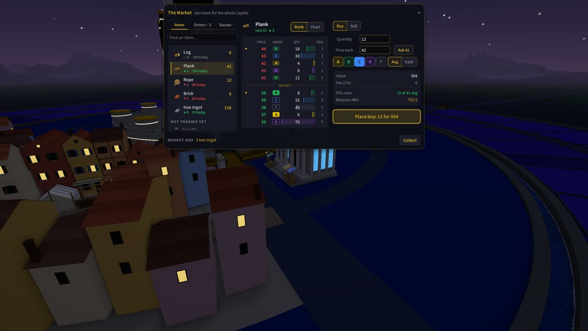

# The Capitol

[](https://github.com/chrischaps/TheCapitol/actions/workflows/ci.yml)



**An online game where the economy is the whole game.** There's no combat. You gather, craft, trade and build in one shared city laid out in rings round a tower. Everyone starts at the edge with nothing and works inward. Every price you pay was set by another player, and every coin in the world was earned by someone's work.

**[Project page](https://chaps.dev/projects/thecapitol/)** · **[Teaser](https://youtu.be/TEASER_ID)** · **[A tour of the game](https://youtu.be/TOUR_ID)**

The game is in development. A Rust server runs the world, and a 3D client on [Flint](https://github.com/chrischaps/Flint), my own engine, lets you stand in it.

## What it is

- **Quality is the economy.** Every item has a quality from 0 to 100, graded A to F. Quality carries down the production chain: rope made from good fiber is better rope, and a workbench made from good rope does better work. A stack shows its mean, but every unit keeps its own quality and its maker's mark.
- **The money is backed by grass.** The currency is the **Strand**, and one Strand is one **Fiber**, the grass that grows everywhere. No computer-run shop prints money.
- **The city is rings.** At the centre is the Capitol, a tower inside a keep. Around it, from the centre out, are:
  - the Bailey and the Trade District
  - the Guild District's 72 halls
  - the urban grid
  - about 1,900 suburban lots on post-war street plans
  - farms on concession roads and lanes
  - the wilds, a ring of mountains, rivers and lakes out to the edge of the world
  
  A moat and two canals divide the rings, and only the bridges cross them.

## What you can do today

- **Gather** fiber from the grass; wood, stone, clay and reeds in the open; iron, copper and tin high in the wilds, where quality rises as you climb. Rivers and lakes block you except at fords and bridges, steep ground slows you, and cliffs stop you.
- **Craft** about 40 kinds of item from 37 recipes at six kinds of station. Tools come in four kinds and three tiers. They wear with use and break, and a better tool does better work.
- **Claim a plot** and watch a house rise on it. Land pays property tax by the hour, and a plot four weeks behind is foreclosed.
- **Automate.** A station on your land runs a recipe from its own box while you're away.
- **Trade at the Exchange:** one order book for the whole world, with buy orders by grade and everything held in escrow. Or trade hand to hand, where both sides must accept.
- **Keep a shop in the bazaar:** 41 stalls rented by the day, each shop named on its sign.
- **Read the Capitol Gazette:** a new edition every game day, with the prices that moved, the finest sale and who made it, the deeds and the busiest hands.
- **Live among citizens:** AI players run by their own process (`capitol-town`). They gather, craft, build, trade and keep stalls, and they earn everything a person does. Each carries a pale lantern so you always know.

Day and night follow the server's clock, so everyone shares the same hour. At night the windows of every claimed house come on.

| | |
|---|---|
|  |  |
|  |  |

## How it's built

- **One server.** The world exists only on a Rust and Axum server, on a 100 ms tick, with PostgreSQL and Redis. Clients send commands and get events over a WebSocket. The wire format is a shared crate (`protocol/`), and every message type has a JSON fixture that must round-trip byte for byte.
- **Generated, the same for everyone.** The roads, the suburb's neighbourhoods, the farms, the wilds' height field and water, the houses and the sounds are all generated from seeds and ids. The default world is pinned by a hash, so a change that moves it has to say so.
- **A 3D client on Flint** (`flint-client/`). Its networking and state live in a crate with no engine in it (`capitol-core`), so they test fast, and the same crate drives the citizens. The camera and HUD are Rhai scripts. Every engine change the game needed went upstream to Flint as a general feature with its own design record.
- **Citizens decide through one cascade:** rules first, then a fast choice model. I measured a Claude layer on the same decisions. It added nothing there and cost far more, so language models are kept for what citizens *say*, not what they choose.

### Built with Claude

The Capitol is built in close collaboration with Claude, Anthropic's AI model: 369 of its 455 commits are co-authored. I set the direction and make the calls. The work is a queue of GitHub issues, about 300 closed so far. Several Claude sessions on more than one machine work it at once. A session claims an issue by pushing a git branch, which only one of them can win (`scripts/issue.sh`).

## Running it

You need Docker, and Rust (`rust-toolchain.toml` pins the version, and rustup installs it). The 3D client is for Windows, on a DirectX 12 or Vulkan GPU.

```bash
docker-compose up -d                     # PostgreSQL and Redis
cd backend && cp .env.example .env && cargo run    # the server, on http://localhost:3000

cd flint-client
play.bat                                 # build release and play against localhost:3000
play.bat --offline fixtures/terrain.json # the city with no server
```

Register on the login form the first time. F1 or `?` in the game lists every control. `flint-client/CLAUDE.md` covers the client's layout, captures, tests and the engine subtree.

The React web client (`client/`) and the LÖVE client (`love-client/`) came first and still build, but they're frozen: new gameplay goes into the 3D client only.

**Packaging.** `powershell -File flint-client/package.ps1` builds a release with a static C runtime and writes `flint-client/dist/TheCapitol-<version>.zip`: the exe, the game's data and a player's README. Unzip it anywhere writable, run `capitol.exe`, and point the login form's "change" link at your server. A server other machines can reach needs `HOST=0.0.0.0` in `backend/.env` (see "Environment Setup" in `CLAUDE.md`).

**Stills and films.** These run offline from the saved world, so they come out the same every time. Both need ffmpeg.
- `powershell -File flint-client/tools/showcase.ps1` takes stills of the city's fixed views and a short crane shot.
- `powershell -File flint-client/tools/teaser.ps1` films the shot library in `flint-client/tools/shots/` and cuts the Instagram reel and the two YouTube films from it.

### Two worlds: with citizens and without

There are two local worlds, and you can run either one or both at once:

| | The usual world | The town |
|---|---|---|
| Citizens | none | 18 of the sim's roles and 2 merchants, to start |
| Start it | `cd backend && cargo run` | `scripts/town.sh up` (Git Bash) or `scripts\town.ps1 up` (PowerShell), from the repo root |
| Server | `http://localhost:3000` | `http://127.0.0.1:3300` |
| Database | `capitol` | `capitol_town` |
| Play in it | `flint-client\play.bat` | `flint-client\play.bat --server http://127.0.0.1:3300` |

The town is the place to see what the city feels like with people in it. The usual world is for work where citizens would get in the way. The two never share anything: what citizens claim, gather or buy in the town stays in the town. The plan is `the-capitol-citizens.md`.

```bash
scripts/town.sh up       # start the town in this terminal; Ctrl-C stops the citizens and its server
scripts/town.sh status   # is its server up, and what each citizen is doing
scripts/town.sh reset    # drop the town's database and roster; the next up starts a new town
```

In PowerShell, `scripts\town.ps1` does the same: `up [-Online n] [-Merchants m] [-AlwaysOn]`, `status` and `reset` (`powershell -ExecutionPolicy Bypass -File scripts\town.ps1 up` if scripts are blocked). Both keep the one town, so either can carry on or reset what the other started.

- **The first `up`** takes a few minutes: it builds the server and `capitol-town`, creates the database (every migration, every node planted), makes an admin for it and mints the citizens. `up --online <n> --merchants <m>` sets how many are on at once. Later runs reuse all of it, and the citizens carry on from where they stood.
- **A new town knows nobody.** Register an account on the client's login form the first time you go in.
- **Switching worlds asks for your password again,** because the client keeps one server's sign-in ([#338](https://github.com/chrischaps/TheCapitol/issues/338)).
- **The town fills up.** Its citizens save up and buy deeds, so its land gets taken the longer it runs. `reset` gives a fresh one.
- **What it keeps** is in `flint-client/town/` (git-ignored): the roster with the citizens' keys, the admin's password, their health (`town.status`), their decision logs and the server's log (`backend.log`). It runs copies of the binaries, so it never locks the exe that `cargo run` rebuilds.
- `TOWN_PORT`, `TOWN_DB` and `TOWN_REDIS` move it to another port, database or Redis db.

Docker has to be up (`docker-compose up -d`), and `backend/.env` must exist: the town takes its `JWT_SECRET` from there.

### Environment variables

Backend `.env`:
- `DATABASE_URL`: the PostgreSQL connection string (port 5433 by default, not 5432)
- `REDIS_URL`: the Redis connection string
- `JWT_SECRET`: the key that signs the tokens
- `HOST`: the address to bind. Use `127.0.0.1` for this machine only, or `0.0.0.0` for the LAN
- `PORT`: the server's port (default 3000)

## The repository

| | |
|---|---|
| `backend/` | The server: Rust, Axum, Tokio, sqlx. Swagger UI at `/swagger-ui` |
| `protocol/` | The wire format and the shared rules, compiled by the server and the client alike |
| `flint-client/` | The 3D client, with the Flint engine as a git subtree at `flint-client/engine/` |
| `client/`, `love-client/` | The first clients, React and LÖVE, now frozen |
| `scripts/` | The issue claims, CI and the town |
| `the-capitol-*.md` | The design, the technical design and a plan for each body of work |

The world is 13,600 units across. The server ticks every 100 ms: movement every tick, crafting and gathering every half second, the market every second, regrowth every minute and tax every hour.

## License

The source is public to read, but it isn't licensed for reuse: all rights reserved.
