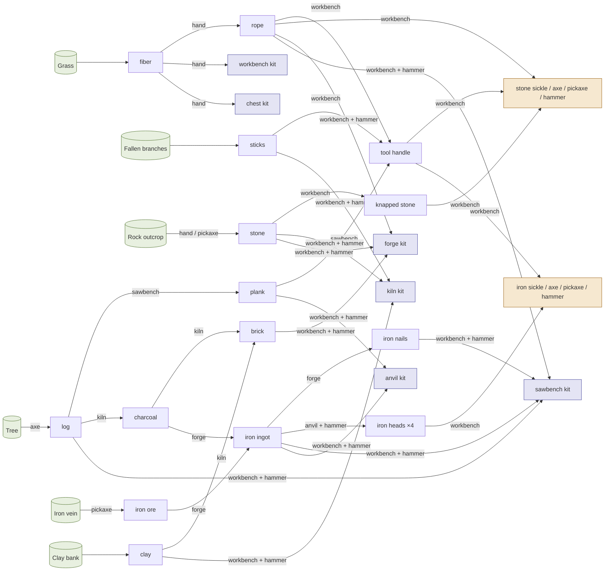

# The Capitol: Economy v1 Plan

**Status:** Planning, written 2026-10-18
**Scope:** Make the economy the game. Quality and tools become real, the content grows deep enough to trade, then an order-book market (M6) and station automation (M8) arrive, with UI in the Flint client only. A health stream (CI, a catalog endpoint, content as data, auth hardening) runs alongside.
**Follows:** [`the-capitol-flint-client.md`](the-capitol-flint-client.md). P0 to P8 of that plan are all built.

**Tracking:** every work package (E0.1 … E4.4) is a GitHub issue labelled [`economy`](https://github.com/chrischaps/TheCapitol/issues?q=label%3Aeconomy) plus its phase label (`ec:E0-foundations` … `ec:E4-automation`). Client work also carries `flint-client`, and engine work carries `engine-upstream`. The issues were created in dependency order, so the lowest open, unblocked issue is next. Agents pick it up with the `next-issue` skill (`.claude/skills/next-issue/SKILL.md`). §6 gives each work package's issue number. When the plan changes, update this doc in the same commit. The plan itself was written under [#143](https://github.com/chrischaps/TheCapitol/issues/143).

---

## 1. Vision

GDD Pillar 1 says the economy *is* the game. Today the game has a beautiful world and a thin economy. You can pull grass, twist it into rope and build a forge, and then the forge has nothing to make.

This plan gives a player reasons to care about what they hold:

- **A good tool is something you're proud of.** Quality comes from your inputs, your bench and your tools, and you can see it. An A-grade iron axe is a possession, and it wears down until you decide to retire it (GDD §6.5).
- **Geography means something.** Wood grows in the rural ring and ore comes out of the wilderness, but the buyers are at the centre. The trip inward that the GDD is built around becomes the logistics of a trade.
- **Prices are public.** An order book in the Trade District, a chart of what fiber fetched today, and a daily Gazette that tells the story of the market. Players learn the economy by watching it.
- **Your workshop keeps working.** Stations you own run your recipes while you're away. A forge glows while it runs and dims when it runs out of ore. Gold spreading across the map now means industry as well as land.

## 2. Goals and non-goals

**Goals**
- The quality cascade works as the GDD describes it (§6.3), and grades survive stacking.
- Hand tools with durability, tools installed in stations, and station quality.
- Enough content that every station has something to make, and enough resources that the zones differ.
- An M6 order-book market that is global, quality-aware and escrowed, with a market panel in the Flint client and a building in the world.
- M8 automation on stations, which keeps running offline for subscribers.
- CI, a `/catalog` endpoint so the client stops hard-coding game data, content as data files, token refresh, rate limits and bot API keys.

**Non-goals for this plan** (see §8, Later)
- M9: guilds, contracts, reputation.
- Bazaar stalls, farm stands, canal tolls, licensing, certification.
- Buffs, consumables, attributes, minigames.
- Conveyors, power and fuel networks, NPC workers.
- UI in the React and Love2D clients. They're frozen and only need to keep compiling.
- Zone-sharded tick engines, deployment, backups, monitoring.

## 3. Where things stand (audit, 2026-10-18)

| Area | State | Where |
|---|---|---|
| Content | 1 resource (grass → fiber), 5 item types, 3 station types, 4 recipes. The longest chain is grass → fiber → rope → forge kit. No recipe needs a forge. | `backend/migrations/2026020{3,4,7}_*.sql`, `20260214_001_station_recipes.sql` |
| Quality cascade | Plain mean plus variance. Recipe `quality_weights` only carry the variance range. No station or tool term. | `engine/crafting.rs:108-113`, `models/recipe.rs:27` |
| Stacks | A merge averages quality, so grades blur away. | `engine/craft_completion.rs:149`, `engine/slot_moves.rs` |
| Stations | Remember `kit_quality` (#88), but it doesn't feed crafting. No tool slot. | `20261017_001_station_kit_quality.sql` |
| Tools | `resource_types.required_tool` exists and nothing reads it. No durability. | `20260203_001_m2_resources.sql:12` |
| Client game data | Hard-coded copy of the seed rows. | `flint-client/crates/capitol-core/src/catalog.rs` ("When the backend grows endpoints for these, fetch them instead") |
| Client estimate | The crafting panel shows the mean of its inputs, labelled "est.". | `capitol-core/src/craft.rs:21-24` |
| Markets, automation, guilds, contracts | Absent. | – |
| CI | None. About 200 backend tests (many `sqlx::test`) and about 500 Flint client tests run by hand. | – |
| Auth | 24 h JWT, no refresh, one session per account (a new login ends the old socket, #78), no rate limits (E0.7 adds them). | `routes/auth.rs:140-213` |
| Trade leftovers | `cleanup_stale_requests` is never called. Trade offer events carry an empty `item_type`. | `engine/trading.rs:299`, `engine/tick.rs:487-492` |

**Loose ends** carried into this plan, but not part of its phases:
- [#115](https://github.com/chrischaps/TheCapitol/issues/115), [#118](https://github.com/chrischaps/TheCapitol/issues/118) and [#119](https://github.com/chrischaps/TheCapitol/issues/119): suburb.
- [#139](https://github.com/chrischaps/TheCapitol/issues/139): Flint emission mix.
- [#141](https://github.com/chrischaps/TheCapitol/issues/141): foreclosure overflow.
- [#142](https://github.com/chrischaps/TheCapitol/issues/142): spike hairlines.
- [#138](https://github.com/chrischaps/TheCapitol/issues/138), the tax-debt notices log, is a prerequisite for E4.3. Automation's pause notices use the same log.

## 4. Design decisions

Each decision is a recommendation. The ones marked **[Chris]** need his call before the work package that depends on them starts. The work package's issue says so, and an agent that reaches it posts the write-up and stops.

### D1. The quality formula (E1.1)

GDD §6.3 is followed literally:

`q = clamp(Σ wᵢ·qᵢ + w_station·q_station + w_tool·q_tool + variance, 0, 100)`

- The weights sum to 1.
- `recipes.quality_weights` grows `inputs: {item: weight}`, `station` and `tool`, which default to an even split over the inputs with `station: 0.2` when the recipe needs a station. (As built in E1.1: the inputs' weights are the existing per-input `quality_weight`, so only `station` and `tool` were added.)
- `qᵢ` is the quantity-weighted mean quality of the units actually consumed for input `i`.
- The formula is one pure function in `protocol::rules` (`quality::output`) that the server and client both call. That turns the client's "est." into an exact `[min, max]` range from the variance bounds, the same move `deposit_quote` made for the exchange fee (P7.2).

### D2. Units keep their quality; a stack shows the mean (E1.2, E1.8) [decided 2026-10-18, revised the same day]

**Every unit keeps its own quality, whatever it's stacked with** (Chris, 2026-10-18). A stack *shows* the quantity-weighted mean, and any unit can always be taken back out at its own quality. Two fiber at 50 and two at 90 show as 70. Pull a 90 out and the 90 comes out as a 90, and the three left show 63 ((50+50+90)/3).

**A stack is a count per quality.** Quality is a whole number from 0 to 100, and two units of a type at the same quality are interchangeable, so nothing is lost by counting them. That's at most 101 rows a stack, never a row per unit, and it's TDD §4.2's `ItemStack` view with exact buckets.

```sql
item_units (item_id → items ON DELETE CASCADE, quality SMALLINT 0..=100, count INTEGER > 0,
            PRIMARY KEY (item_id, quality))
```

- `item_units` is the truth. `items.quantity`, `items.quality` (the mean, rounded down) and `items.min_quality` are cached summaries, kept in step by one writer. The frozen React and Love2D clients read them unchanged.
- **Merging** unions the counts. Nothing is diluted, so any merge of the same type is safe: a drop, gathering, craft output, returns, withdrawals. E1.2's same-grade rule for server-side merges (`auto_stacks_with`) goes, and with it the one-output-slot problem (#191).
- **Taking units out** names which. `split_stack`, trade offers and market escrow can name qualities ("my six 92s"). Otherwise the default pick applies: crafting takes the **best** units first, so what's in the input box makes the best output it can; everything else takes the **lowest** first. The craft range is computed from the units actually taken, on client and server alike.
- **Showing it:** the pip and number are the mean. The tooltip gives the makeup ("6 × 92 A, 3 × 81 B, 1 × 44 D"), as a bar of grade colours when there are many. A stack that spans grades is marked (E1.2's ring).
- **Blending to grade still exists, at the market.** D7's **average** buy order is filled by the mean of the units sold, so a trader can still put surplus quality over a grade line, while the units stay visible. **Every unit** is filled by their min. Crafting still averages its inputs (D1).
- **Migration:** each existing stack becomes one unit row, `(quality, quantity)`. Stacks blended before E1.8 have lost their history and become uniform at their mean.

**As built (E1.2), the first step:** `items.min_quality` (migration `20261102_001`, renumbered from `20261101` in E1.8: it clashed with the off-plot stations' migration, so no `sqlx::test` could migrate), `split_stack` over WS and REST `POST /items/{id}/split` into an empty slot of the same container (another container is #190), and Flint's shift-drag split field. A capture can't hold Shift for egui (#189). Its averaging `Lot` and same-grade `auto_stacks_with` are gone.

**As built (E1.8, [#192](https://github.com/chrischaps/TheCapitol/issues/192)):**
- `rules::stacking::Units` (protocol): a `BTreeMap<quality, count>`, `[[quality, count], ...]` on the wire. `merge` adds counts (refusing past `i32::MAX`), `take(n, Pick)`, `take_units`, `take_quality`, `pick` (look without taking), `mean` (rounded down), `min`, `max`, `spans_grades`. `Pick::Lowest` is the default; `Pick::Best` is crafting's. `quality::Inputs::add_units` feeds the craft range.
- `item_units` (migration `20261103_001`): each old stack became one row. Triggers: an insert seeds one uniform row at its quality; any change to `item_units` rewrites `quantity`, `quality` (`div`, so rounded down) and `min_quality`; and a statement that writes those three straight is refused (`pg_trigger_depth() = 1`), so the summaries can't drift from the units. Every write path goes through `engine::units` (`add`, `merge_into`, `take`, `take_units`, `insert_stack`, `join_first_stack`). `Item.units` reads them through `ITEM_COLUMNS`.
- Merges: a drop, gathering, craft output, foreclosure and take-down returns and exchange withdrawals all join the first stack of their type in slot order, whatever its grade, or take a free slot (a stack that would pass `i32::MAX` takes a slot of its own rather than refusing). #191 is moot.
- Takes: a craft settles its units at the start, the best of each stack first, in the order the client sent the stacks, and completion takes exactly those or fails with "inputs moved". `split_stack` takes `qualities` (adding up to `quantity`) or the lowest. A trade offer settles each line to exact units when it's made (`qualities`, or the lowest), `trade_offer_updated` shows them (`TradeItemInfo.units`), and the trade hands over exactly those or fails. A kit placed takes its lowest unit; kits don't stack, so that's its only one. An exchange deposit takes whole stacks, as before.
- Flint: the pip and number are the mean; a stack that spans grades is ringed in its lowest unit's colour; the tooltip lists "4 × 92 A, 3 × 81 B, 2 × 44 D", or for more than four qualities draws a bar of grade colours with "3 A · 8 B · 4 C · 5 D". The split field adds a row per quality with its own count. The craft check takes the best units first, as the server does; output joins any stack of its type. The Flint trade window still offers counts, so the lowest go: picking qualities there is [#205](https://github.com/chrischaps/TheCapitol/issues/205).

### D3. Tools (E1.4–E1.6)

- **A tool is an unstackable item with durability.**
  - `items.durability` and `item_types.max_durability` hold it.
  - A ToolType (`sickle`, `axe`, `pickaxe`, `hammer`, `saw`) and a material tier go on the item type.
  - The tier is a separate item type (GDD §6.4): `stone_axe` and `iron_axe` are different items.
- **Which tool gets used:** the best matching tool in your inventory, by effective power (`base_power × quality_multiplier(q)`, both in `rules`) times its wear retention. v1 has no equipment slot.
- **Wear:** each use costs 1 durability. Quality retention follows GDD §6.5: full above 20%, linear down to 5%, then a cliff. That curve lives in `rules`. A tool at 0 breaks and leaves the inventory with a notice.
- **As built (E1.4):** `rules::tools`. `quality_multiplier` is the line through GDD §6.4's three points (0.5× at Q0, 1× at Q50, 1.5× at Q100). The GDD's steel example says Q30 for 0.7×, which the line puts at Q20, so the test uses Q20 (at Q30 the steel wins, 14.4 to 14). `base_power` and the base durability are per item type, not derived from the tier; `tier` only names the material. A tool's own maximum is `max_durability(base, q)`, the base scaled by the same multiplier, so it isn't stored. `retention` is 1 down to 20%, a line to 0.5 at 5%, then 0.2 falling to 0 (the cliff).
- **Station tools:** a station has one tool slot. An installed tool supplies the recipe's tool term at that station and wears with every craft there.
- **As built (E1.6):** every crafting station has the slot; a storage station has none. Anyone who may use the station may put a tool in; taking it out follows the box rule (#80): the installer may, and so may the station's owner, which makes it theirs. While installed the tool is an item in no container and owned by no one, so nothing that takes items by owner can reach it, and `stations.tool_owner` remembers whose it is. At the station the installed tool wins over one in your hands, whatever their powers; a recipe whose tool type it isn't falls back to your hands.

### D4. Content as data (E0.3)

Static game data moves out of seed migrations into `backend/content/*.toml`:
- items, resources, stations, recipes and spawn tables
- upserted into the static tables at startup, inside one transaction
- migrations keep the schema only

A validator test checks that:
- every reference resolves
- every item can be obtained
- there are no recipe cycles
- every station type has a kit and something to make

Removing a row is an error unless it's listed under `retired`, so items in players' hands never lose their type. (As built in E0.3: see its row below. Kits are content too, as `kit` on each station.) The client reads the same data through `GET /catalog` (E0.2) and stops copying it.

### D5. Content tree v1 (E2.1)

**Status: approved by Chris, 2026-10-18 (E2.1, #160).** E2.2 to E2.6 build from these tables. The wilds' extra yields (copper and tin, old-growth trees, scree, reeds: `the-capitol-wilds.md` WD8) aren't part of v1. They come in with W6 (#199). Grass stays the starter and the GDD's universal Fiber, and its hand numbers don't change.

v1 has **6 resources, 32 items, 6 stations and 27 recipes**, which is more than the first sketch's 22 items. Most of the extra items are the four iron heads and the four kits that give the new stations a way in. The longest chain is vein → ore → ingot → head → axe, with charcoal from the kiln feeding the forge. Tools and stations both carry quality along it.

#### The tree



The bootstrap order, which every new player walks: grass → rope → workbench → handle and knapped stone → stone axe, pickaxe and hammer → logs and ore → kiln (charcoal) → forge (ingots) → anvil and sawbench → iron tools. No step needs an item that only a later step makes.

#### Tools

The tool types are **sickle, axe, pickaxe and hammer**. D3's `saw` is dropped from v1, because the sawbench is the saw. The ToolType enum can keep the value reserved. There are two tiers, and each is a separate item type (GDD §6.4).

| Tier | `base_power` | `max_durability` at Q50 | Its use |
|---|---|---|---|
| hand (no tool) | 4 | – | grass, branches and clay at today's numbers. Stone by hand is slow and poor. |
| stone | 10 | 60 uses | the bootstrap: the first logs, ore and anvil work. Weak against veins. |
| iron | 18 | 200 uses | the upgrade: more yield, fewer failures, cleaner quality and a longer life |

`quality_multiplier` is 0.5× at Q0, 1× at Q50 and 1.5× at Q100, so an excellent stone pick (Q100, power 15) beats a poor iron one (Q10, power 10.8). That's the GDD's bronze-against-steel example at our two tiers. `max_durability(base, q)` scales the Q50 figure by the same curve, so a Q100 iron axe lasts 300 uses. E1.4 owns the exact formula.

| Tool type | Required for | Optional for (a better tool helps) |
|---|---|---|
| sickle | – | grass (yield) |
| axe | trees | fallen branches (speed) |
| pickaxe | iron veins | rock outcrops (hand is slow) |
| hammer | anvil recipes, and the four kit recipes at the workbench | – |

#### Resources

`difficulty` is set against the tiers' power at Q50: hand 4, stone 10, iron 18. When a tool's effective power is under the difficulty, it's slow and it fails some pulls (GDD §6.2). The suggested failure chance is `clamp((difficulty − power) / difficulty, 0, 0.75)`, and a pull that succeeds keeps its quality. The yields below are the targets at Q50. As built (E2.2), each resource holds them as a yield table by tier, which replaces E1.5's curve. Failures are [#206](https://github.com/chrischaps/TheCapitol/issues/206). Durations and regeneration are in ticks (10 a second). Density is nodes per km² of the zone's open ground (1 unit = 1 m), with a rough count for the default world.

| id | Name → item | Zones (density, about how many) | Cluster | Tool | Difficulty | Yield (hand / stone / iron) | Base quality | Duration | Regen |
|---|---|---|---|---|---|---|---|---|---|
| `grass` | Wild Grass → `fiber` | everywhere off-road, as today | as today | hand, sickle | 0 | 1–3 / 2–4 / 3–5 | 40–70 | 30 | 600 |
| `fallen_branches` | Fallen Branches → `sticks` | Suburban parks 4 (~70), Rural 15 (~250), Wilderness 30 (~150) | under trees, scattered | hand, axe | 0 | 1–2 / 2–3 / 2–4 | 30–65 | 30 (axe 20) | 900 |
| `clay_bank` | Clay Bank → `clay` | Urban 6 (~40), Suburban 2 (~35), along canals and moats (as built, E2.3: the urban bank is lots to the kerb, so urban clay is on the open ground nearest the canal; suburban clay is in the parks) | linear along water | hand | 2 | 1–2 / – / – | 40–80 | 40 | 1200 |
| `rock_outcrop` | Rock Outcrop → `stone` | Rural 6 (~100), Wilderness 20 (~100) | clumped | hand, pickaxe | 8 | 1 at 80 ticks / 1–2 / 2–3 | 30–75 | 50 | 1800 |
| `tree` | Tree → `log` | Rural woods 25 (~400), Wilderness 60 (~300) | woods (noise patches) | axe, required | 12 | – / 1–2 / 2–3 | 35–80 | 60 | 3000 |
| `iron_vein` | Iron Vein → `iron_ore` | Rural 0.5 (~8, rare), Wilderness 8 (~40) | clumped, on rough ground | pickaxe, required | 20 | – / 1 / 1–2 | 25–90 | 80 | 6000 |

Regional tendency: Wilderness nodes draw base quality from the top two-thirds of the range (so 50–90 for a vein), and Rural from the whole range. That is the reason to walk out. E2.2 holds it as a per-zone quality floor in the spawn table.

#### Items

Weights are per unit. Tools and kits don't stack, and everything else does.

| Category | Items (weight) |
|---|---|
| raw_material | `fiber` (0.1), `sticks` (0.3), `clay` (0.5), `stone` (1.0), `log` (3.0), `iron_ore` (1.5) |
| processed_material | `rope` (0.2), `tool_handle` (0.4), `knapped_stone` (0.5), `plank` (1.0), `charcoal` (0.4), `brick` (1.2), `iron_ingot` (1.0), `iron_nails` (0.05) |
| component | `iron_sickle_blade` (0.6), `iron_axe_head` (1.2), `iron_pickaxe_head` (1.4), `iron_hammer_head` (1.2) |
| tool | `stone_sickle` (0.8), `stone_axe` (1.4), `stone_pickaxe` (1.6), `stone_hammer` (1.4), `iron_sickle` (1.0), `iron_axe` (1.6), `iron_pickaxe` (1.8), `iron_hammer` (1.6) |
| placeable | `workbench_kit` (10), `chest_kit` (8), `kiln_kit` (14), `forge_kit` (15), `sawbench_kit` (12), `anvil_kit` (20) |

`component` and `tool` are new categories. A tool's `tool_type`, tier, `base_power` and `max_durability` come from the tool tables above.

#### Stations

| id | Kit | Slots | Recipes |
|---|---|---|---|
| `workbench` | `workbench_kit` | 16 | 14: handle, knapped stone, 4 stone tools, 4 iron tools, 4 kits |
| `sawbench` (new) | `sawbench_kit` | 8 | 2: planks, sawn handles |
| `kiln` (new) | `kiln_kit` | 8 | 2: charcoal, bricks |
| `forge` | `forge_kit` | 12 | 2: iron ingots, iron nails |
| `anvil` (new) | `anvil_kit` | 8 | 4: the iron heads |
| `storage_chest` | `chest_kit` | 16 | – (storage) |

Every crafting station makes at least two things, so E2.4 can remove E0.3's forge exemption.

#### Quality weights by recipe type (GDD §6.3)

These are shares of the whole (D1). The inputs split what's left by their relative `quality_weight`.

| Type | Inputs | Station | Tool | Variance | Used by |
|---|---|---|---|---|---|
| hand | 1.0 | – | – | ±3 | rope, workbench kit, chest kit (unchanged) |
| processing | 0.7 (main ingredient heavy) | 0.3 | – | ±3 | plank, charcoal, brick, ingot, nails |
| craft | 0.4 (0.6 with no tool) | 0.4 | 0.2 (hammer, at the anvil) | ±5 | handle, knapped stone, iron heads |
| assembly | 0.9 (head 2 : handle 1) | 0.1 | – | ±2 | stone and iron tools |
| kit assembly | 0.7 | 0.1 | 0.2 (hammer) | ±2 | kiln, forge, sawbench and anvil kits |

Craft recipes are where a good station or tool can lift output above its inputs. Assembly recipes leave the output to the parts. Processing preserves the main ingredient.

#### Recipes

Durations are in ticks. Inputs are written as `quantity item (relative weight)`.

| id | Station (+tool) | Inputs | Output | Type | Duration |
|---|---|---|---|---|---|
| `rope_basic` | hand | 2 fiber | 1 rope | hand | 50 |
| `craft_workbench` | hand | 10 fiber | workbench kit | hand | 100 |
| `craft_chest` | hand | 8 fiber | chest kit | hand | 80 |
| `tool_handle` | workbench | 2 sticks (0.8), 1 rope (0.2) | 1 tool handle | craft | 60 |
| `knapped_stone` | workbench | 2 stone | 1 knapped stone | craft | 80 |
| `stone_sickle` | workbench | 1 knapped stone (2), 1 handle (1), 1 rope (0.3) | stone sickle | assembly | 100 |
| `stone_axe` | workbench | 2 knapped stone (2), 1 handle (1), 1 rope (0.3) | stone axe | assembly | 120 |
| `stone_pickaxe` | workbench | 2 knapped stone (2), 1 handle (1), 1 rope (0.3) | stone pickaxe | assembly | 120 |
| `stone_hammer` | workbench | 2 knapped stone (2), 1 handle (1), 1 rope (0.3) | stone hammer | assembly | 120 |
| `plank` | sawbench | 1 log | 3 plank | processing | 60 |
| `sawn_handle` | sawbench | 1 plank | 2 tool handle | craft | 60 |
| `charcoal` | kiln | 1 log | 2 charcoal | processing | 150 |
| `brick` | kiln | 2 clay (0.85), 1 charcoal (0.15) | 2 brick | processing | 150 |
| `iron_ingot` | forge | 2 iron ore (0.85), 1 charcoal (0.15) | 1 iron ingot | processing | 200 |
| `iron_nails` | forge | 1 iron ingot | 10 iron nails | processing | 100 |
| `iron_sickle_blade` | anvil + hammer | 1 iron ingot | 1 iron sickle blade | craft | 150 |
| `iron_axe_head` | anvil + hammer | 2 iron ingot | 1 iron axe head | craft | 200 |
| `iron_pickaxe_head` | anvil + hammer | 2 iron ingot | 1 iron pickaxe head | craft | 200 |
| `iron_hammer_head` | anvil + hammer | 2 iron ingot | 1 iron hammer head | craft | 200 |
| `iron_sickle` | workbench | 1 blade (2), 1 handle (1) | iron sickle | assembly | 100 |
| `iron_axe` | workbench | 1 head (2), 1 handle (1) | iron axe | assembly | 100 |
| `iron_pickaxe` | workbench | 1 head (2), 1 handle (1) | iron pickaxe | assembly | 100 |
| `iron_hammer` | workbench | 1 head (2), 1 handle (1) | iron hammer | assembly | 100 |
| `craft_kiln` | workbench + hammer | 10 stone (0.5), 6 clay (0.4), 4 sticks (0.1) | kiln kit | kit assembly | 150 |
| `craft_forge` | workbench + hammer | 12 brick (0.6), 8 stone (0.3), 4 rope (0.1) | forge kit | kit assembly | 200 |
| `craft_sawbench` | workbench + hammer | 4 log (0.5), 1 iron ingot (0.3), 10 nails (0.1), 2 rope (0.1) | sawbench kit | kit assembly | 200 |
| `craft_anvil` | workbench + hammer | 6 iron ingot (0.8), 4 plank (0.2) | anvil kit | kit assembly | 250 |

`craft_forge` changes from today's rope and fiber to bricks and stone. Forge kits already in players' hands are unaffected. There are two routes to a tool handle. The cheap one is sticks and rope. The sawn one is a plank at a sawbench, and it carries the log's quality with a 0.4 station share. That's a choice of quality against effort, and it gives planks a use.

#### Value chain (where prices start)

The anchor is **1 Strand = 1 fiber**. Grass gives about 2 fiber per 3-second pull. With walking and regrowth, that's about 15 fiber a minute at the face, so **one labour-minute is about 15 Strands**. The values below are rough labour, including the inputs and an even share of tool wear. They're starting points for market-maker bots (E3.8) and the sim (E2.7), not prices anyone sets.

| Item | ≈ labour | ≈ Strands |
|---|---|---|
| fiber | 4 s | 1 |
| rope, sticks, clay | 10–15 s | 3–4 |
| plank, charcoal, stone (pick) | 20–25 s | 4–6 |
| log (stone axe), brick | 30–35 s | 8 |
| tool handle, knapped stone | ~1 min | 12–15 |
| iron ore (stone pick) | 1.5 min | ~20 |
| stone tool | 3–4 min | 45–55 |
| iron ingot | 3.5 min | ~50 |
| iron head | 7 min | ~110 |
| iron tool | 9 min | ~130 |
| workbench / chest kit | <1 min | 10–13 |
| kiln kit | 6 min | ~90 |
| forge / sawbench kit | 10 min | ~150 |
| anvil kit | 21 min | ~320 |

At this anchor, a Suburban deed (500 Strands) is about half an hour of grass, and a Rural one (250) is about fifteen minutes. That's cheap next to an anvil. Deed costs aren't part of v1 content, but E2.7's sim should report hours of labour per deed so the two can be tuned together.

**The wilds (2026-10-18).** The Wilderness becomes the wilds: r3800 to r6000, with mountains, rivers and lakes, and no claims (`the-capitol-wilds.md`).
- WD8 there proposes what it yields, for this tree to take or leave:
  - copper and tin veins, which give the `bronze` tier its alloy
  - old-growth trees with a higher ceiling than rural woods
  - stone from scree
  - clay and reeds on the riverbanks
- Here "Wilderness" in the zone column means placed by the land (altitude, slope, water). That placement is W6 ([#199](https://github.com/chrischaps/TheCapitol/issues/199)), not E2.3.

### D6. Where the market is (E3.4) [Chris]

There's **one global order book** (as M6 and the TDD specify). Placing or collecting an order needs you to be within range of the **Exchange hall** in the Trade District:
- Sold items and bought goods wait in your **market box** at the hall until you come.
- Browsing, the chart and cancelling work from anywhere.

This keeps the liquidity of a single book while making the journey inward the logistics of trade, as GDD §3.1 intends. The alternative, trading from anywhere, is simpler and makes the world decorative.

### D7. Market mechanics (E3.1–E3.3)

- Orders are Buy or Sell, for an item type, with a quantity, a price per unit in Strands and, on a buy, a `min_grade` and a `grade_rule`: **average** (the mean of the units sold meets `min_grade`, blends welcome) or **every unit** (their min does). A sell order escrows the units it names, or the default pick. See D2.
- **Escrow:**
  - A sell order moves its items into the market's escrow container.
  - A buy order debits `quantity × price` Strands into escrow.
  - A cancel returns what's left.
- **Fee:** 1% of the order value, charged at placement as a currency sink (M6 notes) and not refunded on cancel. The fee rule is shared in `rules` like the exchange's.
- **Matching:**
  - Runs every 10 ticks (1 s), with price-time priority and partial fills.
  - It trades at the resting order's price.
  - A sell matches a buy only if its stack meets the buy's `min_grade` under the buy's `grade_rule`.
  - Each fill is one DB transaction (TDD §5.2, write-through for economic operations).
- **Lifetime:** orders expire after 7 days. Expiry returns escrow through the market box.
- **History:** `market_trades` keeps every fill. `/market/history` serves OHLC buckets for the chart.

**As built (E3.1, [#167](https://github.com/chrischaps/TheCapitol/issues/167)):**
- `rules::market` (protocol): `listing_fee` (1%, rounded up in integers, so every order pays at least 1), `order_value`, `buy_debit`, `validate` (price 1 to 10⁹ each, quantity 1 to 10,000, so a value fits easily in an `i64`), `ORDER_LIFETIME_SECS` (7 days), `grade_floor` and `meets_grade(units, min_grade, rule)` for E3.2's match test. `OrderSide`, `GradeRule` (`average`, `every_unit`) and `OrderStatus` (`open`, `filled`, `cancelled`, `expired`) live there too.
- Migration `20261104_001_market`: `market_orders` and `market_trades` as above. Trades also keep `min_quality`, for an every-unit chart. There's one shared `market_escrow` container, with no owner and no slots, and a 48-slot `market_box` a player, backfilled and otherwise made the first time it's needed (`engine::market::market_box`).
- **Escrow** (`engine::market`): a sell's units go to a stack of their own in the escrow with no owner, so `move_item` can't reach them, and the order names it (`escrow_item_id`, which goes NULL when a fill uses it up). You sell from your inventory or your market box. A buy's Strands are kept in `escrow_strands`, not worked out from the price: a taker buy filled at a lower resting price has some left over, and **E3.2 must refund that surplus when the buy closes**. On a sell, `min_grade` and `grade_rule` are ignored. On a buy they default to F and average.
- Audit entries: `market_escrow` (a buy's value), `market_fee` and `market_refund`. E3.2's fills will need their own (proceeds to the seller).
- `cancel` returns units to the market box: onto the first stack of the type there if it stacks, otherwise to the first free slot. It's refused if the box is full. `close(order, status)` is the same path with `Expired` for E3.2.
- Wire: `PlaceOrder` is a REST body, since the routes are E3.3. `MarketOrder` and `MarketTrade` are REST DTOs, and `order_placed`, `order_filled {order, trade}` and `order_cancelled` (its `status` says cancelled or expired) are WS server messages for the order's owner. Flint's store ignores them until E3.5.
- The conservation test runs six seeded runs of 120 random places and cancels. After every step, Strands held + open escrow + fees, and every unit of each type, equal the start. Afterwards each balance is its start plus its audit entries.

**As built (E3.2, [#168](https://github.com/chrischaps/TheCapitol/issues/168)):**
- **Which units a fill takes** (`rules::market::fill_units`, shared with the clients): as many as can meet the buy's grade, up to what both orders have left, leaning low. With **every unit**, it's the lowest units at the grade's floor or better. With **average**, it's the most units whose best mean meets the floor, then as many of the lowest as that mean carries, the rest from the top. So a blended lot sells its best to a strict buyer and its rest to anyone, and the seller keeps surplus quality for those who ask for it. Whether a pair can fill at all doesn't depend on quantity, and taking units never makes a lot meet a grade it didn't. So once matching settles, only a new order can make a fill.
- **The book** (`engine::market_book`, pure, no DB): one per item type, loaded at startup from the open orders (`Market::load`). Bids sort by price high to low, asks low to high, and ties go to the earlier `created_at`, then id. Each new order, in the order it came to the book, walks the other side while prices cross, and meets **only orders that came before it**. So a batch arriving in one second trades as if each came alone, and every fill is at the resting order's price. Ineligible orders are walked past and keep their place.
- **Self-trade is refused.** An order walks past its own player's orders and both rest. A wash trade would only cost fees, but it would paint the chart and the Gazette with trades nobody made.
- **One transaction a fill** (`engine::market_matcher::execute_fill`). It locks both orders by id and checks they're as the book had them. It moves the named units to the buyer's market box (the whole escrow stack when it's all of them, so a tool keeps its wear), pays the seller `fill price × quantity` (`market_sale`, straight to the balance: D6's market box holds goods, and Strands aren't goods), and refunds the buyer what they escrowed over the fill price (`market_refund`, per fill). So a buy's escrow is always its price × what's left. Then it writes the `market_trades` row and updates both orders. The book changes only after the commit. A fill that finds an order changed (cancelled under it, say) reloads it from the DB. A buyer whose box is full sits out for 30 s (`STALL_SECS`), then matches against everything, since newer orders walked past it meanwhile. A DB error ends the cycle.
- **Expiry**: each cycle closes orders past `expires_at` through E3.1's `close`. A sell's units go to the box (or the order waits, stalled, if the box is full), a buy's Strands to the balance. Expired orders never trade.
- **Cadence**: a task of its own on a 1 s interval, not the tick loop, so a burst of fills (DB writes) never holds up movement. The book sits behind a mutex that's never held across an await. `AppState.market` is the handle E3.3's routes use: `placed`, `cancelled` and `with_book` for depth.
- **Events**: `GameEvent::OrderFilled` to each party (WS `order_filled`), `OrderClosed` to the owner on expiry (WS `order_cancelled`, with status `expired`), and `MarketTrade` for E3.3's item channel (not sent on the wire yet). Plus `inventory_updated` for the buyer's box and `currency_changed` to whoever was paid or refunded.
- **Numbers**: matching 1,000 new orders against ~10,000 resting takes about 21 ms a cycle on average and 28 ms at worst (release, `market_book_benchmark`). Writing fills is the bound, at about 7.6 ms each, or ~130 a second, on the local Docker Postgres (`market_fill_throughput`). Fewer round trips a fill is [#208](https://github.com/chrischaps/TheCapitol/issues/208).
- **Tests**: the book's unit tests cover the M6 cases, price-time ties, grade walking, blends, self-trade, expiry and stalls, and 40 random books checked for conservation, priority and "nothing left that could trade". `fill_units` is checked against brute force over every sub-lot. E3.1's conservation test is now `places_cancels_and_fills_conserve_strands_and_units`: the matcher runs between random steps, sometimes without being told of a cancel, and at the end the book must equal the DB's open orders.

### D8. Subscriptions (E4.1)

No payments. `accounts.subscription_status` (Free / Active / Lapsed) and `subscription_until`, set by an admin endpoint and by `capitol-bot`. One middleware extractor (`Subscriber`) gates the features in GDD §5's access matrix that this plan touches: automation that runs offline, and later guild leadership.

**As built (#176):**
- `subscription_status` is the old `accounts.tier` column, renamed and constrained. `AccountInfo.tier` and the JWT's `tier` claim still carry it, for the frozen clients.
- The time decides, not the column. An `Active` row past its `until` reads as `Lapsed` (`Subscription::as_of`) and the extractor refuses it at once. The hourly check (`subscriptions::lapse_expired`, half an hour off the tax run) only catches the row up and queues `subscription_lapsed` in `player_notices`, so a player who was away hears it on return.
- Activation adds days to what's left, or starts from now. Two ways in: `POST /admin/accounts/{id}/subscription {days}` (admin), and `POST /player/subscription {days}`, a self-serve stand-in for payment that the server allows only with `MOCK_SUBSCRIPTIONS` on (the default in debug builds only). `capitol-bot --subscribe <days>` uses the second, so a bot needs no admin account.
- The extractor (`subscriptions::Subscriber`) only needs `PgPool: FromRef<S>`. E4.3's tick has no request to extract from: it should call `subscriptions::of` for the owner.
- `/player/me` and `auth_ok` carry `subscription {status, until}`. In Flint, `GameState::is_patron` lights a gold Patron chip beside the name, and the lapse shows as a notice.

### D9. Sessions (E0.8) [Chris]

Today one session per account is enforced on purpose (#78). TDD §6.7 wants several, because of bots, the CLI, and a second device.

The proposal is many **sessions** but one **presence**:
- Each login gets its own refresh token.
- REST works from all of them.
- The newest WebSocket owns the avatar. An older socket is told `superseded` and drops to a read-only view.

Chris decides whether that's wanted, or whether one session stays a rule.

### D10. Workbenches on unclaimed land (#187) [decided 2026-10-18]

A workbench can go down without a plot, so a new player can craft before they can afford a deed.
- **Where:** dry ground that no lot covers: streets, verges, parks, fields, the wilderness. A lot keeps its rule (yours, with room), even an unclaimed one, so claiming a lot never has to deal with a stranger's bench. Water, bridges included, is refused (`rules::in_water`).
- **Which:** a station type's `off_plot` (in `stations.toml`, through `station_types.off_plot` to `/catalog`). Only the workbench has it. A chest off a plot would be storage with no tax, and a forge belongs on property.
- **Who:** the owner alone. A station with no plot has no `station_use_level` to open it (`container_access::station_access`).
- **As built:** `engine::station_placement` holds the placement tests for WS and REST alike (they were two copies). A bench off a plot has `plot_id` NULL. It pays no tax, no plot counts it, and a foreclosure never takes it down.
- **Open ([#188](https://github.com/chrischaps/TheCapitol/issues/188)):** a terrain change can lay a new lot under a bench. The bench stays its owner's, and the lot's owner can't use it or count it. Nothing handles that yet.

## 5. Architecture notes

- **Shared rules first.** Every formula a client previews goes in `protocol/src/rules.rs` with a test that the server uses it:
  - the quality output and range
  - effective tool power and wear retention
  - the market fee
  - grade bands
- **Fixtures for every wire change.** New WS messages get a JSON fixture in `protocol/tests/fixtures/` that round-trips byte for byte.
- **The tick.**
  - Market matching and automation join the tick's 10-tick (1 s) cadence (TDD §3.2).
  - Both work on in-memory state loaded at startup.
  - Both write through per economic operation.
  - Neither holds the `GameState` lock across a DB await (the B8 lesson).
- **The default world.** E2.3 adds seeded nodes against the default terrain:
  - It writes their rows in a migration and keeps `the_default_terrain_moves_no_seeded_node` passing.
  - It doesn't change terrain generation, so `default_terrain_version_is_pinned` stays put.
  - Where a node would sit on a lot, it moves rather than spawns.
  - The wilds (`the-capitol-wilds.md`) do move the default world: W1 shifts every position as the world grows to 12000, and W3 and W5 add water and trails past r3800. E2.3 needn't wait for them, since W1's migration moves its rows like any others. Ore in the ranges and clay on the riverbanks are W6 ([#199](https://github.com/chrischaps/TheCapitol/issues/199)).
- **The Flint client.**
  - New panels follow P5–P7's split: rules in `capitol-core` (pure, tested), egui in `capitol-client/src/ui/`.
  - New world objects follow P8.6b: procedural, seeded by id, merged per sector.
  - Capture flags (`--offline … --<panel>`) let every panel be screenshotted.

## 6. Phases and work packages

Sizes: S is about one session, M is 1–2, L is 2–4.

### E0: Foundations and health

| WP | Work | Size | Depends on |
|---|---|---|---|
| E0.1 [#144](https://github.com/chrischaps/TheCapitol/issues/144) | **CI.** A GitHub Actions workflow. The root workspace runs `cargo test` with a Postgres service, so `sqlx::test` runs, plus clippy. In `flint-client/`, it runs `cargo test -p capitol-core` (live tests stay ignored) and `cargo check -p capitol-client`. **As built:** `.github/workflows/ci.yml` runs two ubuntu jobs on every push (except `claim/**`) and on PRs to master. *Backend and protocol*: clippy `-D warnings` over all targets, `cargo test`, then the `#[ignore]`d database tests with `--ignored` (skipping the two tool tests, `print_node_moves` and `suburb_plan_report`). *Flint client*: ALSA and udev headers, `cargo test -p capitol-core`, `cargo check -p capitol-client --all-targets`. Both cache with `rust-cache`. A run takes about 5½ minutes (the backend job; the client job about 1 to 3), well under the 15-minute limit, so the slow terrain tests stay in. The clippy cleanup deleted dead legacy code (`engine/inventory.rs`, `ContainerState` and others). Code a later issue will wire up keeps an `allow` that names the issue (#147, #148, #157, #167, #176; #148's are gone). Linux built the default world a few road and park vertices apart from Windows (libm), so `default_terrain_version_is_pinned` pinned one hash per platform until [#180](https://github.com/chrischaps/TheCapitol/issues/180) moved the trig to the `libm` crate: one hash again, the one Linux already had. | M | – |
| E0.2 [#145](https://github.com/chrischaps/TheCapitol/issues/145) | **`GET /catalog`.** Item, station, resource and container types and recipes from the DB, versioned by a hash. `capitol-core` fetches it after login, caches it on disk, and `catalog.rs` becomes the offline fallback. **As built:** `GET /catalog` (public) is built once at startup by `engine::catalog::build` from the in-memory tables (container types are now loaded too) and kept in `GameState::catalog`. Lists are sorted by id; `version` is FNV-1a over the JSON, like the terrain's. Station types carry their `kit`. Recipes are all of them, hand and station. `/health` reports `catalog_version`. No ETag: the body is a few KB. In the client, `catalog::Catalog` lives in the store: the snapshot fetches `/catalog` in place of `/recipes`, and a `/health` naming another version refetches it (on the login screen, the session asks itself, since the store is idle there). It's cached per server in `cache/catalog-<server>.json` next to the terrain cache (not `save/`), and survives a sign-out. The fallback, `capitol-core/src/catalog_fallback.json`, is byte-for-byte the protocol fixture `protocol/tests/fixtures/rest/catalog.json` (a test keeps them equal), captured from a seeded server. An item type the client doesn't know gets a name from its id and the placeholder icon. | M | – |
| E0.3 [#146](https://github.com/chrischaps/TheCapitol/issues/146) | **Content as data (D4).** `backend/content/*.toml`, upserted at startup, with a validator test. Today's seeds move across unchanged. **As built:** `items`, `resources`, `containers`, `stations`, `recipes` and `retired.toml`, each documenting its format at the top. They're built into the binary (`include_str!`; cargo rebuilds when one changes), so a server can't start on content from another checkout. `content::load_and_sync` runs after the migrations: it parses (unknown fields are an error), validates, then upserts every table in one transaction, in foreign-key order. A table row the files neither define nor retire stops startup and writes nothing, naming the row and the fix. `content::validate` is the validator: references resolve, ids are unique and not also retired, every item can be had by a player starting empty-handed (a resource yields it given its tool, or a recipe reachable that way makes it, given its station's kit), no recipe cycles, every station's kit is made by a recipe, and every non-storage station is some recipe's station. The forge isn't yet, so it's allow-listed (`NOTHING_TO_MAKE_YET`) until E2.4. Startup runs the validator too, not only `cargo test`. A station type's kit is now content: `kit` in `stations.toml`, the new `station_types.kit_item` column (its migration fills today's three rows, so a database is the same before and after its first sync). Placement, take-down and `/catalog` read it there, replacing four hard-coded copies. The Flint client paired kits through `rules::station_kit_item` until [#181](https://github.com/chrischaps/TheCapitol/issues/181) moved it onto the catalog (`Catalog::station_for_kit` / `kit_for_station`) and deleted the `rules` pair, so a new station is added in the content alone. `/catalog` is byte-identical to before, so the fixture and fallback needed no recapture. Spawn tables stay out: there are none yet, and nodes are world instances. | M | – |
| E0.4 [#147](https://github.com/chrischaps/TheCapitol/issues/147) | **Trade leftovers.** Run `cleanup_stale_requests` on the tick, and fill trade offer events' `item_type`. **As built:** `TradeManager::expire_requests(now)` runs every 10 ticks and drops requests older than `rules::TRADE_REQUEST_TTL_SECS` (30). There was no expired message, so a new one, `trade_request_expired {from_player, to_player}`, goes to both players; capitol-core clears `Requested` or `Incoming` on it and reports `TradeEvent::Expired`, and the client toasts it. `validate_trade_offer` now reads each item's type and quality with the ownership check and names it from `item_types`, so `Command::UpdateTradeOffer` and the `TradeOfferUpdated` event carry finished `TradeItemInfo` lines; the per-connection DB lookups in `ws/connection.rs` are gone. The dead `TradeSession` helpers and `created_at` were deleted. Re-asking no longer resets the age of a request held by the asker. A newer request to the same player replaces the older one, and since [#182](https://github.com/chrischaps/TheCapitol/issues/182) its asker gets `trade_request_expired` for it (sent before the new `trade_request`; the target's client ignores it, as its prompt names the newer asker). | S | – |
| E0.5 [#148](https://github.com/chrischaps/TheCapitol/issues/148) | **Unused protocol messages.** Wire up or delete `currency_changed`, `nearby_nodes`, `nearby_stations`, `item_moved` and `items_merged`, with their fixtures. **As built:** `currency_changed` is wired up, because the balance changes without the player asking (tax, refunds, the other side of a trade). It goes only to the player it names, after every balance change: both sides of a trade that moved strands, a deposit or withdrawal, a deed bought, tax paid off, the hourly tax run (each owner it charged or refunded, read once the run is done and sent last), and the deed refunds of a forced terrain commit. `currency::balances_of` and `announce_balances` are the shared helpers. `capitol-core` stops polling the balance and no longer refetches it after a trade or exchange; `Fetch::Currency` is gone, and the snapshot's `/player/me` still seeds it. The other four were deleted with their fixtures and `GameEvent`s: nodes and stations come from the 5 s polls and the node and station events, and `inventory_updated` already says a container changed. React dropped their cases; the frozen Love2D client still names `nearby_nodes` but never gets it. E0.1's `allow(dead_code)` on `GameEvent` and `Command` came off too, which turned up more dead plumbing, now deleted: the `StationPlaced`/`Opened`/`Closed` events (the connection sends those messages itself) and the stub commands `StopMoving`, `MoveItem`, `PlaceStation`, `RemoveStation`, `OpenStation`, `CloseStation` and `AcceptTrade` (trade accept runs in the connection). The `input_item_ids` field on `Command` looked unused, and was cut as [#183](https://github.com/chrischaps/TheCapitol/issues/183). **As built (#183):** crafting did honour the ids. The WS handler fetches exactly those stacks, owned by the player, in the order sent. But it passed them to the tick through a `pending_craft_items` table keyed by player, so a second `craft` sent before the tick swapped the first one's inputs and was itself dropped without a word. The validated stacks now ride in the command (`inputs: Vec<Item>`), and the table is gone. | S | – |
| E0.6 [#149](https://github.com/chrischaps/TheCapitol/issues/149) | **Token refresh.** `POST /auth/refresh` with rotating refresh tokens in Redis. `capitol-core` refreshes silently before expiry and on a 401. **As built:** `backend/src/sessions.rs`. An account still has one session (#78), but `session:{account}` now holds a random session id (`sid`) and each JWT carries it as a `sid` claim. The middleware and the WS check compare that, not the whole token, so a refresh doesn't invalidate access tokens already in flight, while a new login, a logout or a revoked family ends them all at once. Tokens from before E0.6 have no `sid` and are refused (one re-login). Login and register take `refresh: bool`. With it, the access token lasts `ACCESS_TTL_SECS` (900) and the answer carries an opaque `refresh_token` (32 random bytes; Redis keeps only its SHA-256, at `refresh:{hash}` → `{account}:{sid}`, `REFRESH_TTL_SECS`, 30 days, renewed on each use). Without it, the old 24 h token and no refresh token, so React and Love2D are untouched ([#185](https://github.com/chrischaps/TheCapitol/issues/185) retires that). `AuthResponse` gains `expires_in` and `refresh_token`. `POST /auth/refresh` marks the token used with `SET NX` (of two concurrent uses only one wins) and returns a full `AuthResponse` with the next token, re-reading tier and admin. A second use revokes the family (the session key goes, and the socket is closed). A lost answer therefore signs the client out ([#184](https://github.com/chrischaps/TheCapitol/issues/184): a reuse grace). Logout takes `token` (an expired one is fine) or `refresh_token`, and only ends the session if it's still the current one, so an old client's logout can't end a newer login. In `capitol-core`, `net::Keyring` on the IO thread holds the credentials (`net::Credentials`, from an `AuthResponse` or `Credentials::resume(refresh_token)`). It refreshes at four fifths of the token's life (at most a minute early) on a timer, before any request that finds it due, once after a 401 (the request then goes again, POSTs too, since a 401 is refused before the handler), and before each WS (re)connect, plus once after a WS `auth_error`, which covers a machine that slept through the timer. Refreshes are one at a time behind a lock. `NetEvent::Refreshed` carries each new refresh token to `Auth`, which writes it to `save/session.toml` under `refresh_token` (the old `token` key is ignored). `SignIn` and `capitol-bot` always ask for refresh. | M | – |
| E0.7 [#150](https://github.com/chrischaps/TheCapitol/issues/150) | **Rate limits.** A tower layer per route group (auth by IP, commands by account), with limits in config and a `429` the client understands. **As built:** no new crate: `backend/src/rate_limit.rs` is a token bucket per key that holds a minute's allowance and refills at that rate, so a client can burst to its limit and is then held to the steady rate. `/auth/*` is keyed by peer IP (`rate_limit::by_ip` as a route layer; the server now runs `into_make_service_with_connect_info`, with no `X-Forwarded-For` trust, since nothing sits in front of it). Authenticated REST is keyed by account and category in `auth_middleware`: `Inventory` (`/inventory/*`, `/player/inventory`, 120), `World` (other writes, 60) and `Read` (other GETs, 120: the client's polls plus a bot scouting `/world/nearby` each second; the TDD has no row for them). WS commands are counted per connection (60), and one over the limit gets `error` naming the command. Unauthenticated `/health`, `/terrain` and `/catalog` aren't limited. Market read and write (TDD 120 and 30) join with E3.3. The limits are env vars (`RATE_LIMIT_AUTH_PER_MIN`, `_READ_`, `_WORLD_`, `_INVENTORY_`, `_WS_PER_MIN`), and `RATE_LIMITS=off` turns them off. Over the limit: `429`, `Retry-After` in whole seconds, and `{error, retry_after}`. capitol-core's `rest::execute` waits out a `429` (honouring `Retry-After`, at most 30 s) and sends again, any method, since a `429` was refused before anything ran, up to 4 times before reporting it. A local swarm logs every bot in from one address, so it needs `RATE_LIMIT_AUTH_PER_MIN=1000` (or `RATE_LIMITS=off`); the other limits never touched 24 wandering bots in 2 minutes. The buckets are in-process, which is right for one backend. | S | – |
| E0.8 [#151](https://github.com/chrischaps/TheCapitol/issues/151) | **Sessions (D9) [Chris].** Many sessions and one presence, or a recorded decision to keep one. | M | E0.6 |
| E0.9 [#152](https://github.com/chrischaps/TheCapitol/issues/152) | **Bot API keys.** Scoped keys (`read`, `play`, `trade`) an account can mint and revoke. `capitol-bot` logs in with one. **As built:** `backend/src/api_keys.rs`, table `api_keys` (migration `20261025_001`). `POST`/`GET /account/api-keys` and `DELETE /account/api-keys/{id}` (`routes/account.rs`) take only the player's own token. A key can't manage keys, and never reaches `/admin`. At most 10 live keys per account, with a name of 1 to 64 characters and at least one scope. The secret is `cap_` plus 64 hex (`rest::API_KEY_PREFIX`), shown once. Only its SHA-256 is stored, with the first 12 characters kept to tell keys apart in the list. `last_used_at` is written at most once a minute, and revoked keys stay in the list with `revoked_at`. The middleware takes `Authorization: ApiKey <secret>` (or `Bearer <secret>`; the prefix tells a key from a JWT), and `api_keys::rest_scope` maps method and full path to a scope. Every GET needs `read`. Move, extract, inventory move and station place or remove need `play`. Exchange, plot claim, pay-tax and permissions need `trade`. Any route not listed is closed to keys, so a new route has to be given a scope (E3's market routes will want `trade`). `play` and `trade` imply `read`. **A key isn't a session:** it doesn't replace the account's login, so a bot on a key leaves its owner signed in over REST. The WebSocket takes the secret as the `auth` message's `token` (no protocol change), and `api_keys::ws_scope` checks every command; a refusal is an `error` naming the command and the missing scope. **A `read`-only key watches:** it doesn't call `connect_player`, so it doesn't take the player over and the owner's client stays connected. It also doesn't take the player's waiting notices. A `play` or `trade` key's socket does take the player over, as a second login's socket would, until #151 decides presence. Revoking closes the key's sockets through `GameState::watch_key`/`revoke_key`, and a check after the watch is registered covers a revocation that lands mid-handshake. In capitol-core, a token that starts with `cap_` goes out as `ApiKey` and is never refreshed. `RestRequest` gained `CreateApiKey`, `ApiKeys` and `RevokeApiKey`. `Bot::with_api_key` and `capitol-bot --api-key <secret>` (or `$CAPITOL_API_KEY`) play as the key's own player. With a read-only key, the bot says it can only watch and stops. Not subscriber-gated yet: TDD §6.9 says subscribers only, which is E4.1's call (#176). TDD §6.9's eight fine-grained permissions became these three scopes. | M | E0.6 |

### E1: Quality and tools

| WP | Work | Size | Depends on |
|---|---|---|---|
| E1.1 [#153](https://github.com/chrischaps/TheCapitol/issues/153) | **The weighted cascade (D1).** `rules::quality::output` and `output_range`; `quality_weights` grows its weights; crafting uses it; the client shows the exact range. **As built:** `protocol/src/rules/quality.rs`. `Weights::for_recipe` fills the gaps and normalises. The input weights are the recipes' existing per-input `quality_weight`, read as relative shares; they were already in the content, so `quality_weights` didn't grow an `inputs` map. It grew optional `station` and `tool`, which are shares of the whole: left out, a station recipe gives the station 0.2 and the tool gets 0. The inputs split the rest, and an all-zero split is even. `Inputs` keeps each input's quantity-weighted mean. `output` is `clamp(round(base) + variance, 0, 100)`. `output_range` is that at both variance ends. `terms` is the breakdown. `RecipeInfo` (and so `/catalog`) carries the resolved `quality_weights`, so the client needs no defaults of its own. The fixture and fallback were recaptured. The server rolls the variance (`engine::crafting::output_quality`); stations counted as 50 until E1.3. The server now takes units from the stacks in the order the client sent them (`fetch_player_items` sorted to the request), so the client's count of what's taken is the server's. A property test runs 1000 crafts through `start_crafting`/`process_crafting` against the client's range. The validator checks the weights: none negative, station plus tool at most 1, `variance_min ≤ variance_max`, at least one input. The Flint panels show "64–70 C", or "52–58 D–C" across a grade boundary (`theme::range_badge`), with a breakdown on hover. The React panel still shows its own mean (it's frozen). `RecipeInput.quality_weight` widened to f64 so the weights come out clean. | M | – |
| E1.2 [#154](https://github.com/chrischaps/TheCapitol/issues/154) | **Free blending, no blending behind your back (D2).** Manual merges blend any grades; server-side merges join only same-grade stacks; `min_quality` per stack; `split_stack` (WS and REST), and shift-drag to split in Flint. *Done: see D2's as-built. Follow-ups #189 (engine: scripted keys to egui), #190 (split into another container), #191 (one output slot).* | M | E1.1 |
| E1.3 [#155](https://github.com/chrischaps/TheCapitol/issues/155) | **Station quality.** `kit_quality` becomes the station's quality (rename it, or alias it), feeds the station term, and shows in the station panel. **As built:** the column stays `stations.kit_quality`; code reads it as `quality` (`models::STATION_COLUMNS` selects `kit_quality AS quality`), so no migration. `Station`, `StationState`, `StationInfo` and `station_placed` carry `quality` (fixture). `CraftingOperation` holds the station's quality from the start of the craft, so taking the station down mid-craft can't change it. Hand crafts pass `quality::NO_STATION` (0), which a hand recipe weights 0; `UNRATED_STATION_QUALITY` is gone. In `capitol-core`, `craft::check_at` takes the station's quality (`GameState::open_station_info`) and `check` is the hand case. The Flint station panel shows "Station quality: 82 B" with the share and points it adds to the picked recipe, e.g. "20% of this recipe, +16.4". Test: the same inputs at a 95 and a 40 station always come out apart (`a_better_station_makes_better_output`). | S | E1.1 |
| E1.4 [#156](https://github.com/chrischaps/TheCapitol/issues/156) | **Hand tools (D3).** Durability, ToolType, tier, effective power and the wear curve in `rules`; best-tool selection; breakage with a notice. **As built:** `protocol/src/rules/tools.rs`: `ToolType` (sickle, axe, pickaxe, hammer, saw), `Tier` (stone, bronze, iron, steel), `quality_multiplier`, `effective_power`, `max_durability`, `retention`, and `best_tool` over `Tool`s by power × retention (ties to the first, a spent tool never). Migration `20261028_001` adds `item_types.tool_type`, `tier`, `base_power` and `max_durability` (all or none, and a tool can't stack) and `items.durability`. In content a tool is `tool = { tool_type, tier, base_power, max_durability }` on its item. The validator checks the type and tier, power and durability above 0, that tools don't stack, and that recipes make them one at a time. `models::ITEM_TYPE_COLUMNS` and `ITEM_COLUMNS` are now the one column list for every `SELECT`. `SlotItem` and `InventoryItem` carry `durability` and `max_durability` (omitted for non-tools, so older fixtures are unchanged), and `/catalog` item types carry `tool` (fixture and fallback recaptured). A crafted tool starts at `max_durability(base, q)` in a slot of its own. `engine::tools`: `best_tool(db, player, type)` looks only in the `player_inventory`; `wear(conn, item)` takes 1 and deletes the tool at 0, inside the caller's transaction; `announce_broken` sends `tool_broke {item_id, item_type, item_name}` (new message and fixture) and `inventory_updated`. Nothing wears a tool yet: E1.5 calls these. The Flint client toasts "Your Stone Sickle broke". The test tool is `stone_sickle` (power 6, 60 uses at Q50), from 2 rope and 4 fiber at a workbench, since there's no stone yet; E2.4 changes its recipe. Fixed on the way: unstackable items (kits as well as tools) no longer merge, in a slot move (they swap) or in the crafting output (a second one finds it full). `the_content_is_what_the_migrations_seeded` became `the_content_keeps_what_the_migrations_seeded`: the seeded rows come through the sync unchanged, and a second sync changes nothing. | L | E1.1 |
| E1.5 [#157](https://github.com/chrischaps/TheCapitol/issues/157) | **Tools at work.** Extraction honours `required_tool`, and the tool's power sets yield and speed, its retention scales quality. Craft recipes take a tool term. **As built:** the tool comes from the player's inventory (`engine::tools::tool_for_node` and `tool_for_recipe`). REST and WS look it up before queueing, and it rides on `StartExtraction`, `StartCrafting` and `CraftAtStation`. Resources gained `tool_type` and `difficulty` (migration `20261029_001`). `required_tool` is now a tool type, not an item, and it implies `tool_type`. The validator checks both, and treats a gate as passable only once a tool of that type can be had. Grass is worked by a sickle at difficulty 6, so a Q50 stone sickle is leverage 1. The numbers are in `rules::tools` as `leverage` (power over difficulty, capped at 4), `tool_yield`, `tool_duration`, `max_damage` and `gathered_quality`. Yield is ×(1 + 0.5·leverage), rounded and never below the hand roll. Duration is ÷(1 + 0.25·leverage), so grass takes 30 ticks by hand and 24 with the stone sickle. Quality is `min(node, round(node × retention) − damage)`, with damage rolled in `0..=round(5 / leverage)` (at most 15). That follows GDD §6.2: a tool never beats the node, and a poor or worn one damages the yield. Hand gathering keeps its old node ± 5. So a sickle trades a little quality for half again the fiber, faster, rather than making better fiber. A recipe names its tool in `crafting_requirements = { tool_type }`, and it must give the tool a `quality_weights.tool` share, and only then (validated). Without the tool it refuses ("You need a hammer to make …"). The tool term is `term_quality`, quality × retention. Wear happens in the transaction that writes the result: `wear_held` wears the tool only while it's still in the player's inventory. A craft whose tool has left fails (`TOOL_MOVED`), and so does a gather that needs the tool. Any other gather falls back to what hands would have rolled. So `extraction_completed` is now sent after the item is written, like `crafting_completed`. Both carry an optional `tool: {item_id, item_type, durability, max_durability}` (`ws::ToolUse`; the `extraction_completed` fixture shows it), followed by `tool_broke` on its last use. `/catalog` resource types gained `tool_type` and `difficulty`, and recipes gained `tool_type`, all left out when unset (fixture and fallback recaptured). The station's own tool slot is E1.6, and showing the wear in Flint is E1.7. | M | E1.4 |
| E1.6 [#158](https://github.com/chrischaps/TheCapitol/issues/158) | **Station tool slot.** Install and remove (WS), wear per craft, the tool term at that station. **As built:** migration `20261031_001` adds `stations.installed_tool` (item, `ON DELETE SET NULL`, unique) and `tool_owner`, and a trigger that deletes a still-installed tool when its station row is deleted any other way (a forced terrain commit, #141), so no tool is left loose. `engine::station_tools`: `install_tool` and `remove_tool` (WS `install_tool {station_id, item_id}` and `remove_tool {station_id}`, under `check_station_access`; storage stations refuse, one tool per slot, only a tool with uses left, only from your inventory). Each answers with a broadcast `station_tool_changed {station_id, tool}` plus `inventory_updated`, or `error`. `StationInfo` and `/stations/nearby` carry `tool: StationTool {item_id, item_type, quality, durability, max_durability, owner_id}` (left out when empty). `tool_for_station_recipe` picks the station's tool when its type matches, else your best (`HeldTool.station_id` says which). `finish_craft` wears it with `wear_installed`, which locks the station and wears only while the tool is still in the slot; one taken out mid-craft fails it (`STATION_TOOL_MOVED`). Its last use empties the slot, `tool_broke` goes to its owner, and `station_tool_changed` follows every craft that wore it. Taking the station down puts kit and tool in the owner's inventory (two free slots, or it refuses). Foreclosure returns the tool to whoever installed it, or the station owner, after the kits; one with no room is lost with the station. Flint keeps `station.tool` up to date; showing it is E1.7. | M | E1.3, E1.4 |
| E1.7 [#159](https://github.com/chrischaps/TheCapitol/issues/159) | **Flint: quality you can read.** Grade and durability on slots and tooltips, the crafting panel's exact range with what drives it (inputs, station, tool), and the station panel's tool slot. **As built:** the client's craft check now counts the tool term, which it had left at 0 since E1.5: `capitol_core::craft::tool_for` picks the tool as the server does (the station's installed tool when its type matches and it has uses left, else the best held one by power × retention, ties to the first slot), `check`/`check_at` take it, and `Check::missing_tool` holds back a craft the server would refuse. `Check::lifts` gives what an A-grade (Q90) station or tool would raise the range's floor to. Slots: a tool shows a 3 px wear bar in place of the quantity (steel, ember below 20%, breathing below 5%, the `rules::tools` knees). Tooltips add the tier and type, power with its quality multiplier, uses left, what the wear keeps, and each resource of its type's yield, speed and most damage (the slots get the catalog once a frame, `slots::know_catalog`). The preview has a 0–100 bar of where the points come from (each input in violet, the station orange, the tool steel, the roll a pale band, grade lines ticked), a key, the tool line ("The station's Stone Sickle 48 D, worn: counts 43") and the lifts. The station panel has the tool slot under the box: drag a tool in (`install_tool`), drag it out to the inventory or press Take out (`remove_tool`); refusals show as a refused move. A broken tool's slot throws off an ember ring and shards (`slots::shatter`), beside the existing toast. `stone_sickle.svg` is drawn. `--ui-sample` holds sickles at three wear levels, breaks one at 6 s, and its preview is the real one for a made-up fiber + station + sickle recipe. Checked live against a backend with a sickle term on `craft_forge` (test only, not committed): the client said 59–65 and the server made 59, and the installed sickle wore from 10 to 9. | M | E1.5, E1.6, E1.8 |
| E1.8 [#192](https://github.com/chrischaps/TheCapitol/issues/192) | **Units keep their quality (D2, revised).** `item_units` (a count per quality) under every stack; the cached mean, min and quantity; merges union, takes name their units (best first for crafting, lowest first otherwise); `split_stack` and trade offers by quality; Flint shows the makeup. Replaces E1.2's averaging; makes #191 moot. *Done: see D2's as-built. A trade offer settles to exact units when it's made; the summaries can only be written through `item_units`. Follow-up [#205](https://github.com/chrischaps/TheCapitol/issues/205) (choosing qualities in Flint's trade window).* | L | E1.2 |

### E2: Content depth

| WP | Work | Size | Depends on |
|---|---|---|---|
| E2.1 [#160](https://github.com/chrischaps/TheCapitol/issues/160) | **Content tree v1 (D5) [Chris approves].** Final list of resources, items, stations, recipes and weights, written into D5 with the quality weights per recipe type. **As built (pending approval):** 6 resources, 32 items, 6 stations and 27 recipes. Tool types are sickle, axe, pickaxe and hammer, with `saw` dropped because the sawbench is the saw. Stone tools are handle + knapped stone + rope, and iron tools are an anvil-made head + handle. `component` and `tool` are new item categories. `craft_forge` moves to bricks. The value chain's anchor is 1 labour-minute ≈ 15 Strands. | S | E0.3 |
| E2.2 [#161](https://github.com/chrischaps/TheCapitol/issues/161) | **Resource types.** Difficulty, tool gating, yield by tool, and zone spawn tables in content data. **As built:** all six D5 resources are in `resources.toml`. Each has a `difficulty` (now on every resource, ≥ 0), a `yields` table by `hand` and tier (`{min, max, ticks?}`), a `cluster` and `spawns` (`{zone, density, quality_floor?}`). These are in the protocol's `rules::resources`, the DB (`yields`, `cluster`, `spawns` JSONB) and `/catalog`. A gather rolls the row for its tool's tier, or the best tier below it (bronze reads stone), or `hand`. That table replaces E1.5's `tool_yield` curve, which couldn't reproduce D5's yields. `leverage` counts difficulty as at least `HAND_POWER` (4), so D5's 0s work: a Q50 stone tool is leverage 2.5 on grass and branches (30 → 19 ticks, D5's "axe 20"). A tool still sets speed and quality damage. A resource has a `hand` row exactly when it needs no tool. Hand-on-rock's 80 ticks is the row's `ticks`. Wilderness quality floors are the bottom of the top two-thirds of the range (a vein's is 47, not D5's rounded 50). D5's failure chance isn't built: [#206](https://github.com/chrischaps/TheCapitol/issues/206). So that logs and ore can be had, it also adds the D5 raw items, the tool handle, knapped stone, and the stone axe and pickaxe with their recipes. E2.4 builds on these. Regeneration was already per type (`regeneration_ticks`). | M | E2.1, E1.5 |
| E2.3 [#162](https://github.com/chrischaps/TheCapitol/issues/162) | **Seeded nodes by zone.** Deterministic placement from the terrain (woods in clusters, outcrops, veins, clay by the water), clear of roads, water and lots, written by a migration. Ore in the ranges and clay on the wild riverbanks come later from the land, in W6 ([#199](https://github.com/chrischaps/TheCapitol/issues/199)). **As built:** `engine::node_spawn::plan(terrain, tables, existing, seed)` places `density × the zone's ring area` nodes per spawn row. *Woods* are where a seeded value-noise field is in its top 8% over the zone's open ground. *Under trees* is 12–45 from a tree planned in the zone. *Clumped* is knots of 1–5 within 35 of a centre. *Along water* is a bank strip 18–48 from the kerb. A pattern with nothing to go by falls back to the zone's parks, then to scattering. Every node is 30 from roads (clay 18 from the water), 10 off lots, out of parks unless placed in them, and 12 from every other node. `plan_with` takes an extra land test for W6. Grass (seeded already) and Wilderness rows (W6) aren't placed. The default world gets 944 nodes: rural trees 426, branches 256, outcrops 103 and veins 9; urban clay 42; suburban park branches 72 and clay 36. **Clay deviates from D5:** lots run to the outer canal's kerb, so urban clay stands on the urban ring's nearest open ground, which is its rim against the suburb. The suburb has no water, so its clay is in the parks. Chris judges this. The migration can't insert into `resource_nodes`, because the types come from the content sync, which runs after migrations ([#207](https://github.com/chrischaps/TheCapitol/issues/207)). So it writes `resource_node_seeds`, and startup's `plant_seeds` moves them in once their types exist. Ids are seeded, so an admin regenerate (`replan`, saved at commit by `save_replan`) re-plans the same nodes on the default world, and other nodes on another world. `backend/tools/node-plan.ps1` draws the plan. | L | E2.2 |
| E2.4 [#163](https://github.com/chrischaps/TheCapitol/issues/163) | **Seed content v1.** The new items, stations, kits and recipes through the content pipeline. Every station makes something.  **As built:** D5's 32 items, 6 stations and 27 recipes in `backend/content/`, the weights by recipe type as D5's table has them (station share explicit on every station recipe, the hammer's 0.2 at the anvil and on the four kit recipes). Recipe ids are D5's, except the stone sickle's, which keeps E1.4's `craft_stone_sickle`. The stone sickle moves to D5's stone tier (power 10, from E1.4's 6; weight 0.8). `NOTHING_TO_MAKE_YET` is gone: every crafting station makes something. Built alongside E2.2, which landed first with the resources, the raw items and the stone axe and pickaxe; E2.4 adds the rest of the tree on top. The station-to-kit pairing needed nothing beyond `kit` in `stations.toml`, since #181 put it on the catalog. `engine::crafting`'s `the_longest_chain_carries_quality_from_the_ore_to_the_axe` crafts from raw stuff to an iron axe through the shipped recipes (`RecipeDef::to_recipe`, `ItemDef::to_item_type`). It runs once with fine stuff and once with poor, and once at A stations and once at D. It doesn't gather: the raw stuff is handed to it, and E2.2's tests cover gathering each resource. `engine::catalog`'s ignored `the_catalog_fixture_is_the_content` checks the protocol fixture and the client fallback against a synced DB, and rewrites both with `CATALOG_FIXTURE=write`. The live Flint station test crafts a `tool_handle` now, with sticks put in by SQL until E2.3 seeds branches (`flint-client/CLAUDE.md`). | M | E2.1, E0.3 |
| E2.5 [#164](https://github.com/chrischaps/TheCapitol/issues/164) | **Flint: the new nodes.** Procedural trees, branch litter, rock outcrops, iron veins and clay banks, with grass clearings (H25) and a depleted look. **As built:** `flint-client/.../nodes/` (`models.rs` the meshes, `mod.rs` the layer, `sample.rs` the offline `--node-sample`). A model per catalog resource id, with a cairn for any id the client doesn't know (`Kind::Other`). Trees come in four species (oak, beech, birch, pine), with two shapes each, weighted by zone (farmland oak and beech, the wilds pine, the town birch). Each spent look is lower than its full one: stubble, a stump with a pale cut face, leaf litter, a low broken rock in rubble (a vein's dug out dark), a dug-out bank. Felled trees topple, and regrow from a sapling over 3.2 s. **Merged per sector** (`nodes_r3w05`): a node at rest is baked into its sector's mesh, and only a node that's aimed at, worked, taken, regrowing or new has an entity. Particles `gather_wood`, `gather_stone` and `gather_clay` play while a node is worked, with a burst as it's taken. Grass clearings are per kind (`Kind::clearing`). Placement goes through `nodes::ground_at`, for W9. **Beyond the plan:** the client used to know only the nodes within 80 m, so the woods would have grown in as you walked. A new `GET /world/nodes` (the whole list, about 1100 nodes on the dev DB) is fetched with the snapshot and on `terrain_updated`. It always replaces the store's nodes, and the nearby poll only merges now, even after a resync. `cap_nodes()` gives scripts only the nodes being worked or aimed at, and each mark carries `kind` and `r` for ring sizes. **Measured** live with all 1100 nodes, uncapped at 1280×720 on the RTX 4070: street zoom 4.1 ms and 18 draws; district 4.9 ms and 98 draws. | L | E2.3, E0.2 |
| E2.6 [#165](https://github.com/chrischaps/TheCapitol/issues/165) | **Flint: items and stations.** Icons for every new item and models for sawbench, kiln and anvil, all from the catalog. *Built (E2.6):* 26 new SVGs in `assets/icons/`, in P5.2's style. The tools share one drawing per kind, leant 38°: the stone tier is knapped flint lashed in gold cord, and the iron tier is dark iron with its edge ground bright and a gold rivet. The anvil's four heads are the same heads unhafted, with their eye and a gold maker's mark. A type the catalog knows but no file draws takes its category's icon, `assets/icons/categories/<category>.svg`: the category's shape in slate with a gold question tag. The catalog reaches `icons.rs` through `slots::know_catalog`. A type the catalog doesn't know keeps `fallback.svg`. `--icon-sheet` now shows the whole catalog, in slots too, and the stand-ins. The models in `stations.rs`: a trestle sawbench with a toothed blade standing through the top, a crank, a log half through and sawdust under it; a beehive kiln of brick in courses, with a gold hoop, an arched firebox whose mouth glows, a hot vent and stacked firewood; and an anvil on a stump, with a hammer on its face and a quench bucket. An unknown type is a plank crate rather than React's grey block. The kiln has `particles/kiln.particles.toml` (smoke and sparks from the vent). The forge's and kiln's glow follow the hour through H23's `material.emissive_scale` (`stations::fire_light`): ×1 by day, ×1.8 at night. `--station-sample` (offline) stands one of every station in a row before the camera for captures. Tests check every catalog item has an icon and every catalog station a model of its own. | M | E2.4, E0.2 |
| E2.7 [#166](https://github.com/chrischaps/TheCapitol/issues/166) | **Economy sim.** `capitol-bot --sim`: a swarm gathers and crafts headless against a local stack for N hours (with a time multiplier), then reports throughput, quality spread per item and tool wear. Used to tune E2.4. **As built:** `capitol_core::sim`. `sim::plan` is a pure planner. It walks the content tree back from a goal, one step at a time: gather (with the resource's required tool, made first), craft (at the bot's own station, made and placed first), place a kit (a workbench anywhere, D10; anything else on the bot's plot), claim a plot, or deposit fiber for the deed. `sim::Role` deals 20 bots by largest remainder: 4 fiber, 3 wood and 3 ore gatherers; 2 plank, 3 ingot and 2 tool crafters; and 3 builders, who put down all six stations and then make bricks. Bots don't trade, so each climbs its own chain. `SIM_TICK_SCALE` (1 to 100, debug builds only) divides the tick period. Everything counted in ticks speeds up, the hourly tax included; wall-clock things (rate limits, token lifetimes, trade expiry, the market's task) don't. `/health` gains `sim_tick_scale` when it isn't 1. The report (`renders/sim/sim-<stamp>.md` and `.csv`) gives units per game hour, p10/p50/p90, first-made time, seconds a unit against D5's labour, tools worn out, tax, deeds, bot-hours by step and why steps failed. Found on the way: REST `/stations/place` never put the station in the tick's memory, so it couldn't be crafted at until a restart (`Placed::remember` now serves WS and REST). Also, the store took any `/plots` listing as your own plots. **The first run** (20 bots, 2 game hours, 12 wall minutes): the 9 rural veins starve the iron tier (ore at 841 s a unit against D5's 90; 7 ingots, no iron tools). Logs come at 6 s against D5's 32. Tax took nothing. A Rural deed is half an hour of grass. Tuning is [#210](https://github.com/chrischaps/TheCapitol/issues/210), and bots that can't route round water are [#211](https://github.com/chrischaps/TheCapitol/issues/211). No content changed in E2.7: the vein fix re-plans the seeded nodes, which needs its own migration. | M | E2.4 |

### E3: Markets (M6)

| WP | Work | Size | Depends on |
|---|---|---|---|
| E3.1 [#167](https://github.com/chrischaps/TheCapitol/issues/167) | **Market model (D7).** `market_orders`, `market_trades`, the escrow container and market boxes; DTOs and fixtures in `protocol`; the fee in `rules`. *Built: see D7's E3.1 as-built.* | M | E1.2 |
| E3.2 [#168](https://github.com/chrischaps/TheCapitol/issues/168) | **Matching engine.** On the 1 s cadence, with price-time priority, partial fills, `min_grade`, expiry, one transaction per fill, and exhaustive tests. *Built: see D7's E3.2 as-built.* | L | E3.1 |
| E3.3 [#169](https://github.com/chrischaps/TheCapitol/issues/169) | **Market API.** REST create, cancel, list (book depth), my orders and history (OHLC); a WS `market:<item>` channel; fill notices. | M | E3.2 |
| E3.4 [#170](https://github.com/chrischaps/TheCapitol/issues/170) | **Where trading happens (D6) [Chris].** The Exchange hall's position in the Trade District on `/terrain`, the range check on place and collect, and collecting from the market box. | S | E3.3 |
| E3.5 [#171](https://github.com/chrischaps/TheCapitol/issues/171) | **Flint: market panel.** Browse items with activity, a bid/ask ladder, the order form with fee preview, my orders, fill toasts. | L | E3.3 |
| E3.6 [#172](https://github.com/chrischaps/TheCapitol/issues/172) | **Flint: price chart and history.** `egui_plot` candles or line with volume, by grade. | M | E3.5 |
| E3.7 [#173](https://github.com/chrischaps/TheCapitol/issues/173) | **Flint: the Exchange hall.** A procedural building in the Trade District that opens the panel in range and lights up at dusk. The market box shows when goods wait. | M | E3.4, E3.5 |
| E3.8 [#174](https://github.com/chrischaps/TheCapitol/issues/174) | **Market-maker bots.** `capitol-bot --market` quotes both sides around a reference price, for liquidity on a local stack and in E2.7's sim. | S | E3.3, E2.7 |
| E3.9 [#175](https://github.com/chrischaps/TheCapitol/issues/175) | **The Capitol Gazette.** A daily digest built from the day's trades, deeds and records (biggest movers, best-quality sale, new deeds, top producers), served by REST and posted on a notice board by the tower. It gives the economy a story. | M | E3.3 |

### E4: Automation (M8)

| WP | Work | Size | Depends on |
|---|---|---|---|
| E4.1 [#176](https://github.com/chrischaps/TheCapitol/issues/176) | **Subscriptions (D8).** Status, an admin and bot activation, and the `Subscriber` extractor. *Done: see D8's as-built note.* | S | – |
| E4.2 [#177](https://github.com/chrischaps/TheCapitol/issues/177) | **Automation config.** A recipe and a repeat count or "forever" per station; `PUT /stations/{id}/automation`, start and stop; the station's own container is its input and output. **As built:** `stations.automation` JSONB (migration `20261109_001`, NULL until first configured) holds `rest::StationAutomation {recipe_id, mode, state, done}`. `mode` is `{"count": n}` (1 to `automation::MAX_COUNT`, 10 000) or `"forever"`; `state` is `stopped`, `running` or `paused` with a `reason` (`PauseReason`: `missing_input {item_type}`, `output_full`, `tool_broken`, `tool_missing`, `owner_offline`), flattened into the object. TDD §4.3's `Manual` pause is `stopped` instead. `done` counts crafts since the last start. `engine::automation`: `configure` (stops it, `done` 0), `start` (from stopped `done` goes to 0, a paused station keeps it, a running one is left alone), `stop` (keeps setting and count). One check, `check_config`, at configure and again at start: a crafting station with a box, a recipe whose `required_station_type` is this station's type (hand recipes refused), the recipe's tool type in the station's slot with uses left, a count in range. **Owner only, and no range check**, so an owner can stop a station from afar; loading the box stays the box rule's (#80). REST `PUT /stations/{id}/automation`, `POST …/automation/start` and `…/stop` (API-key scope `play`) answer the `StationAutomation`; WS `configure_automation`, `start_automation`, `stop_automation`. Both broadcast `station_automation_changed {station_id, automation}`, and a refusal is an `error` (400/403/404 over REST) with the reason. `StationInfo.automation`, left out when never configured. capitol-core keeps it on the station for E4.4. **For E4.3:** the setting lives only in the DB, not on `StationState`; a partial index on `automation->>'state'` finds the stations that aren't stopped. | M | E1.6, E2.4 |
| E4.3 [#178](https://github.com/chrischaps/TheCapitol/issues/178) | **Automation tick.** On the 1 s cadence: pull inputs, craft with the cascade, push the output, wear the tool, and pause on MissingInput, OutputFull, ToolBroken or OwnerOffline. Subscribers keep running offline. Pauses go to the notices log. | L | E4.1, E4.2, [#138](https://github.com/chrischaps/TheCapitol/issues/138) |
| E4.4 [#179](https://github.com/chrischaps/TheCapitol/issues/179) | **Flint: automation.** A panel on the station (recipe, run and stop, status, production log). In the world, running stations glow and smoke (H23 emission, particles) and paused ones dim. | M | E4.3 |

## 7. Dependency graph and estimate

```
Quality and tools   E1.1 ─┬─ E1.2 ─ E1.8 ───────────────────── E3.1 ─ E3.2 ─ E3.3 ─┬─ E3.4 ─┐
                          ├─ E1.3 ─┬─ E1.6 ─┬─ E1.7                                ├─ E3.5 ─┴─ E3.7
                          └─ E1.4 ─┴─ E1.5 ─┘                                      │    └─ E3.6
                                      │                                            ├─ E3.9
Content             E0.3 ─ E2.1 ─┬─ E2.2 ─ E2.3 ─ E2.5   (E2.5, E2.6 also need E0.2) └─ E3.8 (+E2.7)
                                 └─ E2.4 ─┬─ E2.6
                                          ├─ E2.7
Automation          E1.6 + E2.4 ──────────┴─ E4.2 ─ E4.3 ─ E4.4      (E4.3 also needs E4.1 and #138)
Health              E0.1   E0.2   E0.4   E0.5   E0.7   E0.6 ─┬─ E0.8
                                                             └─ E0.9
```

| Phase | Sessions (approx.) |
|---|---|
| E0 | 9–13 |
| E1 | 9–13 |
| E2 | 10–15 |
| E3 | 12–17 |
| E4 | 5–8 |
| **Total** | **about 45–66** |

E0 and E1 can run in parallel worktrees from the start. E2.1 and E1.2 are the first decision points for Chris (E1.2 decided 2026-10-18, and revised the same day into E1.8: see D2).

## 8. Later (outside this plan, but planned for)

- **M9 social:** guilds (registry, roles, treasury, dues), contracts with escrow, and reputation. The market's escrow and the notices log are their foundations.
- **Shops:** bazaar stalls and farm stands (GDD §3.4), sold from a plot or a rented stall, which the market box generalises to.
- **The bureaucracy's other fees** (GDD §8.4): deed transfer, canal tolls, certification, licensing.
- **Buffs, consumables, minigames** (GDD §6.3, §7), and NPC workers and conveyors for automation (GDD §3.7).
- **M7 leftovers:** deed items and transfers, enforcing plot permissions on entry, the map, the ownership overlay, the permissions editor.
- **Admin egui panels** gated on `is_admin`.
- **M10 operations:** deployment, backups, monitoring, load tests, zone-sharded ticks (TDD §7).

## 9. Risks

| Risk | Mitigation |
|---|---|
| A market with few players has no liquidity | Market-maker bots (E3.8). The sim (E2.7) shows where supply pools. |
| Balance: one chain dominates or nothing is worth making | The sim reports throughput and value per hour per chain. Content as data makes tuning a TOML edit. |
| New nodes move the default world, or land on owned lots | E2.3 writes migrations, skips lots, and keeps the default-world tests green. |
| Grade-banded stacks fill inventories | Watch slot pressure in the sim. A sort-and-stack button is cheap if it bites. |
| Escrow bugs lose items or Strands | Every fill and cancel is one transaction, with property tests for conservation (items and Strands in = out + fees). |
| Decisions block agents | D2, D6 and D9 and the E2.1 tree are flagged in their issues. Agents write up and stop rather than guess. |

## 10. Verification strategy

- Backend: `cargo test -p capitol-backend` (with the docker stack up for `sqlx::test`), plus the work package's named tests. CI runs it all from E0.1 on.
- Shared rules: a test in `protocol` for each formula, and a test that the server calls it.
- Client: `cargo test -p capitol-core` and `cargo build --release -p capitol-client` from `flint-client/`, with offline captures into `flint-client/renders/` for anything visual, and [H] for Chris's eye.
- End to end: `capitol-bot` drives each feature against a local stack: gather with a tool, craft with a station, place and fill orders, run an automated station overnight.
